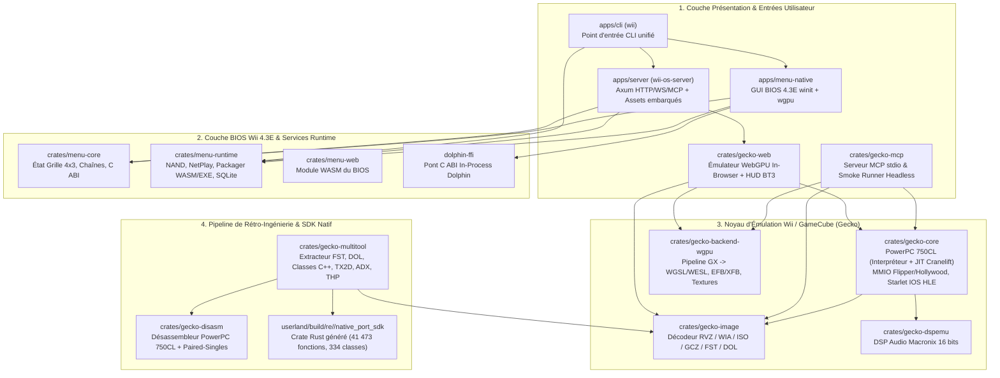
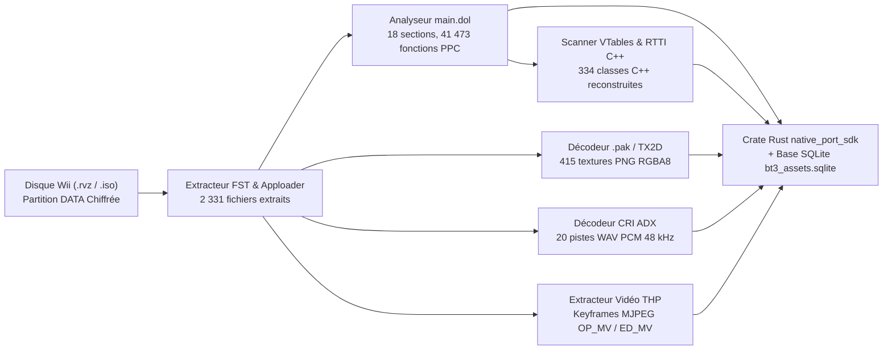

# Architecture Technique de Wii OS (Édition Pure Rust 2026)

Ce document décrit l'architecture interne du monorepo **Wii OS**, l'organisation de ses crates Rust, le fonctionnement du moteur d'émulation Wii/GameCube **Gecko** (PowerPC 750CL + WebGPU + IOS HLE), ainsi que le pipeline de **Rétro-Ingénierie & Portage Natif (`native_port_sdk` + `@bun-os/re`)**.

---

## 1. Principes Directeurs de l'Architecture

1. **Monorepo Cargo Unifié (`Edition 2024`, `Resolver 3`)** :
   - Toutes les composantes — du modèle de menu BIOS 4.3E (`wii-menu-core`) jusqu'au compilateur JIT PowerPC (`gecko-core`), au moteur de rendu WebGPU (`gecko-backend-wgpu`), au serveur Axum (`wii-os-server`) et au CLI unifié (`wii-cli`) — partagent un unique [`Cargo.toml`](Cargo.toml) et [`Cargo.lock`](Cargo.lock).
2. **Binaire Unique Auto-Hébergeable (`wii` / `wii.exe`)** :
   - Le binaire `wii` embarque directement le serveur HTTP/WebSocket/MCP (`wii-os-server`), l'interface native GPU (`wii-menu-native`), les ressources Web du BIOS 4.3E et le bundle WebAssembly/WebGPU compilé de `gecko-web`.
   - Aucune dépendance externe de serveur web (Nginx, Node.js, Python) n'est requise au runtime : `wii serve` configure automatiquement les en-têtes d'isolation cross-origin (`Cross-Origin-Opener-Policy: same-origin` et `Cross-Origin-Embedder-Policy: require-corp`) indispensables à WebGPU et `SharedArrayBuffer`.
3. **Double Exécution : WebGPU In-Browser & Natif Desktop** :
   - **Dans le navigateur (`wasm32-unknown-unknown`)** : `gecko-web` compile `gecko-core` et `gecko-backend-wgpu` en WebAssembly et exécute directement les jeux Wii (`.rvz`/`.iso`/`.dol`) sur le GPU via l'API **WebGPU** et **WebAudio**.
   - **Sur Desktop Windows/Linux (`x86_64`)** : `wii-menu-native` et `gecko-app` utilisent `winit + wgpu` (backends natifs Vulkan / Direct3D 12) ou le pont in-process C ABI [`dolphin-ffi`](dolphin-ffi/src/lib.rs).

---

## 2. Topologie des Crates et Couches Logicielles

---

## 3. Architecture Interne de `gecko-core` (Émulateur Wii / GameCube)

Le crate [`crates/gecko-core`](crates/gecko-core/src/lib.rs) implémente l'architecture matérielle complète de la Nintendo Wii (nom de code *Revolution*, SoC **Hollywood** + CPU **Broadway** PowerPC 750CL @ 729 MHz) et de la GameCube (SoC **Flipper** + CPU **Gekko** @ 486 MHz) :

### 3.1 CPU PowerPC 750CL (`crates/gecko-core/src/gekko/`)
- **Jeu d'instructions complet** : Entiers 32 bits, unité flottante IEEE-754 64 bits, et unité SIMD **Paired-Singles (`ps_*`)** propre aux processeurs Gekko/Broadway avec quantification matérielle via les registres `GQR0..GQR7`.
- **Double moteur d'exécution** :
  - **JIT Cranelift (`crates/gecko-core/src/gekko/jit/`)** sur `x86_64` / `aarch64` pour une exécution native ultra-rapide des blocs de base PowerPC.
  - **Interpréteur portable optimisé** sur `wasm32-unknown-unknown` et en repli pour les instructions auto-modifiantes (`icbi`).
- **MMU & Traduction d'adresses** : Support complet des registres `IBAT0..7` / `DBAT0..7` (avec `HID4` `SBE` activant les 4 BATs supplémentaires de la Wii pour mapper la `MEM2` à `0x9000_0000`) et des tables de pages (`SDR1`).

### 3.2 Horloge Système 64 bits (`OS_SYSTEM_TIME`) et Interface Série (`SI`)
Lors de l'initialisation d'un disque Wii dans [`crates/gecko-core/src/wii.rs`](crates/gecko-core/src/wii.rs#L219-L221) :
- Le SDK Revolution (`__OSGetSystemTime` à `0x8020D4F0`) calcule l'heure système 64 bits en additionnant le registre matériel `Time Base` (`TBU:TBL` cadencé à `60,75 MHz`, soit `729 MHz / 12`) à la variable globale 64 bits signée `OS_SYSTEM_TIME` stockée en mémoire basse à `0x8000_30D8..0x8000_30DF`.
- Les 32 bits de poids fort (`0x0000_30D8`) et de poids faible (`0x0000_30DC`) sont initialisés à `0`, garantissant une horloge monotone positive dès la première instruction du jeu.
- Le contrôleur `SI` ([`crates/gecko-core/src/flipper/si/regs.rs`](crates/gecko-core/src/flipper/si/regs.rs#L24-L34) et [`crates/gecko-core/src/flipper/si/si.rs`](crates/gecko-core/src/flipper/si/si.rs)) déclenche immédiatement `update_polling()` et `refresh_interrupts()` lors de l'écriture dans `SiPoll` (`0xCD00_6430`) ainsi qu'à chaque début de trame (`System::begin_frame`), permettant à `SIGetType`, `SITransfer`, `PADInit` et `WPAD` de détecter les manettes dès la frame 1.

### 3.3 Co-processeur Starlet IOS HLE & `MemoryNandVfs` (`crates/gecko-core/src/hollywood/ipc/`)
La Wii délègue l'accès à la mémoire flash NAND, au lecteur DVD chiffré, au Bluetooth (Wiimote `WPAD` via `/dev/usb/oh1/57e/305`) et à la carte SD au processeur ARM9 **Starlet** via le bus IPC (`0x0D00_0000`).
- [`crates/gecko-core/src/hollywood/ipc/fs/host.rs`](crates/gecko-core/src/hollywood/ipc/fs/host.rs) implémente **`MemoryNandVfs`**, un système de fichiers NAND virtuel transactionnel 100 % en mémoire compatible à la fois avec `wasm32-unknown-unknown` (navigateur sans système de fichiers OS) et les exécutions headless.
- L'arbre NAND standard (`/title/00010000/52445350/data`, `/tmp`, `/sys/uid.sys`, `/shared2/sys/SYSCONF`) est pré-provisionné au démarrage, permettant aux jeux comme *Budokai Tenkaichi 3* de vérifier l'espace libre (`ISFS_GetUsage`), créer leurs fichiers de sauvegarde (`DBZ3_DATA.DAT`) et les relire sans erreur.

---

## 4. Pipeline Graphique WebGPU (`crates/gecko-backend-wgpu`)

Le GPU **GX** de la Wii (Flipper/Hollywood) repose sur un pipeline configurable à **16 étages TEV (Texture Environment)**, des matrices de position/normale indexées en mémoire (`CP` / `XF`) et un **Embedded Framebuffer (EFB)** de 2 Mo.

- **Traduction dynamique TEV -> WGSL/WESL** : [`crates/gecko-backend-wgpu/src/render.rs`](crates/gecko-backend-wgpu/src/render.rs) génère et met en cache à la volée les shaders WebGPU correspondant exactement à la configuration TEV, au blending, à l'alpha-test et au Z-buffer de chaque draw call GX.
- **Décodage de textures matérielles** : Supporte tous les formats GX (`I4`, `I8`, `IA4`, `IA8`, `RGB565`, `RGB5A3`, `RGBA8`, `C4`, `C8`, `C14X2` avec palettes `TLUT`, et compression S3TC/DXT1 `CMPR`).
- **Copies EFB / XFB** : Gère les copies `EFB -> Texture` (utilisées pour les effets d'aura, de flou et les portraits dans *Budokai Tenkaichi 3*) et `EFB -> XFB` pour l'affichage final en `640×528` (PAL 50 Hz) ou `640×480` (PAL 60 Hz / NTSC).

---

## 5. Pipeline de Rétro-Ingénierie & SDK de Portage Natif

Pour accompagner le portage natif d'un titre Wii vers Rust et l'inspection temps réel, Wii OS intègre une chaîne d'outils complète dans [`crates/gecko-multitool/src/re_extract.rs`](crates/gecko-multitool/src/re_extract.rs) couplée à **`@bun-os/re`** et **`@aphrody/bun-engine`** :

Tous les artefacts générés sont stockés de manière déterministe dans `userland/build/re/<game-slug>/` et exposés à la fois :
- via le CLI : `wii re --game budokai-tenkaichi-3-eu`
- via l'API HTTP : `GET /v1/re/inspect/budokai-tenkaichi-3-eu`
- dans l'inspecteur de symboles temps réel du HUD WebGPU (`/emulator/index.html`).
