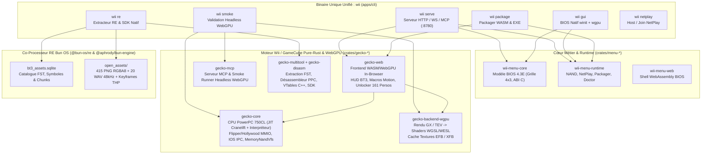

# Wii OS — BIOS 4.3E Pixel-Perfect, Émulateur WebGPU In-Browser, NetPlay & SDK de Portage Natif (Édition Pure Rust 2026)

**Wii OS** est une plateforme unifiée et auto-hébergeable écrite en **Rust (Édition 2024 / Stack 2026)** qui combine dans un **seul binaire exécutable (`wii` / `wii.exe`)** :

1. **Interface BIOS Wii System Menu 4.3E Pixel-Perfect** (grille `4×3` paginée, bannières animées, horloge temps réel, Wii Message Board, gestionnaire de mémoire NAND/SD, barre d'état NetPlay, effets sonores et animations authentiques).
2. **Émulateur Wii & GameCube WebGPU In-Browser (`gecko-web` + `gecko-core`)** capable d'exécuter *Dragon Ball Z: Budokai Tenkaichi 3* (`RDSPAF` PAL) de bout en bout directement dans le navigateur via **WebAssembly + WebGPU + WebAudio**, avec support natif **Wiimote + Nunchuk + Pointeur IR + Accéléromètre 3 axes + Macros Motion (Kamehameha, Genkidama, Transformation/Fusion) + Déblocage 100 % des 161 personnages + NAND virtuelle transactionnelle en mémoire (`MemoryNandVfs`)**.
3. **Pont Natif Haute Performance (`dolphin-ffi` + `wii-menu-native`)** intégrant un rendu natif `winit + wgpu` (D3D12 / Vulkan) et l'exécution in-process C/C++ ABI de Dolphin sans perte de performances.
4. **Packager de Jeux Autonomes (`wii package`)** générant en une commande des bundles **WebAssembly/WebGPU (`.zip` / PWA)** ou des **exécutables Windows autonomes (`.exe` + `.boot.json`)** avec vérification cryptographique `SHA-256`.
5. **Pipeline de Rétro-Ingénierie & SDK de Portage Natif (`gecko-multitool re-extract` + `@bun-os/re` + `@aphrody/bun-engine`)** extrayant automatiquement l'intégralité d'un disque `.rvz`/`.iso` (système de fichiers FST, désassemblage PowerPC 750CL des sections `.text`, reconstruction des classes C++ et tables virtuelles `vtables`, décodage des textures GX `.tx2d` en `.png` RGBA8, décodage des pistes audio CRI `.adx` en `.wav` PCM 48 kHz, extraction des vidéos `.thp`, et génération d'un crate Rust compilable `native_port_sdk`).

---

## Vue d'ensemble de l'Architecture



---

## Structure du Monorepo

Le workspace Cargo racine ([`Cargo.toml`](Cargo.toml)) fédère l'ensemble des applications et bibliothèques autour d'un unique [`Cargo.lock`](Cargo.lock) :

```text
wii-os/
├── Cargo.toml                  # Workspace Cargo unique (resolver = "3", édition 2024)
├── README.md                   # Documentation principale du produit
├── ARCHITECTURE.md             # Architecture technique détaillée (BIOS, Gecko, WebGPU, RE)
├── docs/
│   ├── BUDOKAI-TENKAICHI-3-PORT-AND-WEBGPU.md  # Guide RE & preuve WebGPU de DBZ BT3 (RDSPAF)
│   ├── gecko/                  # Documentation matérielle PowerPC 750CL, GX, DSP & schémas
│   └── archive/                # Notes d'investigation historiques et archives
├── apps/
│   ├── cli/                    # Binaire unifié `wii` (serve, gui, package, re, smoke, netplay, nand, doctor)
│   ├── server/                 # Serveur Axum HTTP/WebSocket/MCP (`wii-os-server`) avec assets embarqués
│   ├── menu-native/            # Interface BIOS 4.3E native GPU (`winit` + `wgpu` + manettes `gilrs`)
│   └── menu-gtk/               # Hôte natif Linux GTK4 / Wayland
├── crates/
│   ├── menu-core/              # Machine à états pure-Rust du menu Wii 4.3E + ABI C (`wii_menu_core.h`)
│   ├── menu-runtime/           # Services runtime : NAND, NetPlay, Packager WASM/EXE, validation SHA-256
│   ├── menu-web/               # Bindings WebAssembly du menu Wii 4.3E
│   ├── gecko-core/             # Émulateur Wii/GameCube (PowerPC Gekko/Broadway, JIT Cranelift, IOS, MemoryNandVfs)
│   ├── gecko-backend-wgpu/     # Backend graphique WebGPU (pipeline GX/TEV, shaders WESL/WGSL, EFB/XFB)
│   ├── gecko-web/              # Application WebGPU/WASM in-browser avec HUD DBZ BT3 et contrôles Wiimote/Nunchuk
│   ├── gecko-mcp/              # Serveur MCP d'introspection d'émulateur & runner de test WebGPU headless
│   ├── gecko-multitool/        # Outil CLI d'extraction RVZ/ISO/GCZ/WAD et générateur de SDK de portage (`re-extract`)
│   ├── gecko-disasm/           # Désassembleur PowerPC 750CL + extensions Paired-Singles Gekko
│   ├── gecko-image/            # Lecteur/convertisseur de disques Wii/GameCube (ISO, RVZ, WIA, GCZ, DOL)
│   ├── gecko-dbglib/           # Bibliothèque de débogage, points d'arrêt et symboles PowerPC
│   ├── gecko-debugger/         # Interface graphique de débogage (`egui`)
│   └── gecko-dspemu/           # Émulateur DSP audio Macronix 16 bits
├── dolphin-ffi/                # Pont C/C++ FFI vers Dolphin (`wii_dolphin_ffi.h`) pour l'exécution in-process
├── frontend/                   # Assets du shell Web BIOS 4.3E (HTML5, CSS3, WebGPU canvas, PWA, audio)
├── menu/                       # Catalogue des chaînes Wii (`catalog.example.json`) et spécifications
└── userland/                   # Données locales de l'opérateur et artefacts générés (ignorés par Git)
    ├── data/wii/               # Disques `.rvz`/`.iso`, NAND Wii, WADs, base SQLite (`wii-os.sqlite3`)
    └── build/
        ├── packages/           # Bundles autonomes générés (`budokai-tenkaichi-3-eu-wasm`, `...-exe`)
        └── re/                 # SDK de portage natif, textures PNG, pistes WAV, captures WebGPU & SQLite RE
```

---

## Démarrage Rapide

### 1. Compiler le binaire unifié `wii` et le moteur WebAssembly

```powershell
# 1. Compiler le runtime WebGPU pour le navigateur (crates/gecko-web/pkg)
wasm-pack build crates/gecko-web --target web --no-opt

# 2. Compiler le binaire unifié `wii`, le serveur et le runner WebGPU MCP
cargo build -p wii-cli -p wii-os-server -p mcp
```

### 2. Lancer le serveur tout-en-un (BIOS 4.3E + Émulateur WebGPU + NetPlay + MCP)

```powershell
cargo run -p wii-cli -- serve --bind 127.0.0.1:8780
```

Ouvrez ensuite dans un navigateur compatible WebGPU (Chrome, Edge, Brave, Firefox Nightly) :
- **Menu BIOS Wii 4.3E** : `http://127.0.0.1:8780/`
- **Mini-Jeu Shenron & Portail CDN Shenron** : `http://127.0.0.1:8780/shenron`
- **Lancement direct WebGPU de *DBZ: Budokai Tenkaichi 3* via CDN Shenron** :
  `http://127.0.0.1:8780/emulator/index.html?game=/cdn/shenron/games/budokai-tenkaichi-3-eu.rvz&autoboot=1`
- **Manifeste du CDN Shenron** :
  `http://127.0.0.1:8780/v1/cdn/shenron/manifest`
- **Inspection JSON du SDK de Rétro-Ingénierie** :
  `http://127.0.0.1:8780/v1/re/inspect/budokai-tenkaichi-3-eu`

---

## Référence Complète du CLI `wii`

Le binaire `wii` ([`apps/cli/src/main.rs`](apps/cli/src/main.rs)) centralise toutes les opérations du produit :

| Sous-commande | Description | Exemple |
| :--- | :--- | :--- |
| **`wii serve`** | Démarre le serveur HTTP/WebSocket/MCP auto-hébergé avec headers `COOP/COEP` | `wii serve --bind 127.0.0.1:8780` |
| **`wii gui`** | Lance la fenêtre BIOS Wii 4.3E native accélérée par GPU (`winit` + `wgpu`) | `wii gui` |
| **`wii package`** | Empaquette un jeu du catalogue en bundle **WASM** (`.zip`) et/ou **EXE** autonome | `wii package --game budokai-tenkaichi-3-eu --format both` |
| **`wii re`** | Inspecte ou exécute le pipeline de Rétro-Ingénierie & SDK de portage natif | `wii re --game budokai-tenkaichi-3-eu --extract` |
| **`wii smoke`** | Exécute `N` frames du jeu en WebGPU headless et capture les écrans `.png` + télémétrie | `wii smoke --frames 3600` |
| **`wii netplay`** | Héberge, rejoint ou inspecte une session multijoueur NetPlay | `wii netplay --game budokai-tenkaichi-3-eu --mode host` |
| **`wii nand`** | Inspecte les blocs mémoire, sauvegardes et chaînes de la NAND Wii | `wii nand` |
| **`wii doctor`** | Vérifie l'état de santé du workspace, de la NAND, des disques et des toolchains | `wii doctor` |
| **`wii catalog`** | Affiche les catalogues JSON (`menu`, `formats`, `repositories`, `dependencies`) | `wii catalog menu` |

---

## Émulateur WebGPU In-Browser & Fonctionnalités Natives (*Budokai Tenkaichi 3*)

Le runtime WebGPU ([`crates/gecko-web`](crates/gecko-web/src/lib.rs) et [`crates/gecko-web/index.html`](crates/gecko-web/index.html)) embarque un HUD complet dédié à la Wii et à *Dragon Ball Z: Budokai Tenkaichi 3* (`RDSPAF`) :

- **Contrôles Hybrides Wiimote + Nunchuk & Manette GameCube** :
  - **Clavier / Souris** : Stick Nunchuk (`WASD`), Croix directionnelle (`Flèches`), Pointeur Infrarouge IR (`Souris` sur le canvas), Bouton `A` (`J` / `X` / `Entrée` / `Espace`), Bouton `B` (`K` / `Z` / `Clic Droit`), Nunchuk `C` (`U` / `C`), Nunchuk `Z` (`I` / `V`), Boutons `1` (`1`), `2` (`2`), `-` (`-`), `+` (`=` / `Backspace`), `HOME` (`H`), Secousse Wiimote (`Shift`).
  - **Manettes WebGamepad API** : Détection automatique Xbox / DualSense / Switch Pro / GameCube Adapter avec mapping analogique double stick et gâchettes.
- **Macros Motion One-Click (Accéléromètre 3 axes + Combinaisons BT3)** :
  - **🔥 Kamehameha / Blast 2** (`Touche Q` ou bouton HUD) : Maintient `B + Z` et injecte l'impulsion d'accéléromètre avant (`[0.0, 2.5, 0.0]`).
  - **🌐 Genkidama / Ultimate Blast** (`Touche E` ou bouton HUD) : Maintient `B + Z + Bas` et injecte l'impulsion verticale (`[0.0, 0.0, 3.0]`).
  - **✨ Transformation / Fusion** (`Touche R` ou bouton HUD) : Déclenche `1 + C + Shake` (`[2.2, 0.0, 2.2]`).
- **🔓 Déblocage Instantané des 161 Personnages & Arènes (`Unlock 100% Roster`)** :
  - Génère et injecte à chaud dans la NAND virtuelle en mémoire (`MemoryNandVfs`) le fichier `/title/00010000/52445350/data/DBZ3_DATA.DAT` avec les masques de déblocage complets (161 combattants, 35 arènes, mode *Dragon History* 100 %, *Ultimate Battle*, 9 999 999 Z-Points).
- **⚡ Bascule PAL 50 Hz / EurRgb60 (60 Hz)** :
  - Modifie à chaud le registre `VI DCR` et l'adresse basse mémoire `0x8000_00CC` (`TV_MODE = 5` EurRgb60) pour un rendu fluide à 60 FPS.
- **💾 Save States Instantanés & Capture PNG** :
  - Sérialisation/désérialisation complète de l'état de la machine en mémoire (`Save State` / `Load State`) et capture d'écran WebGPU directe.
- **🔬 Inspecteur Temps Réel du Compteur Programme (PC) PowerPC** :
  - Résout l'adresse `PC` courante du CPU Gekko/Broadway dans la table des `41 473` fonctions extraites par le pipeline RE.

---

## Packaging Autonome (`WASM` & `EXE`)

La commande `wii package` produit deux formats prêts à être distribués ou auto-hébergés sous `userland/build/packages/` :

1. **Bundle WebAssembly / WebGPU (`budokai-tenkaichi-3-eu-wasm`)** :
   - Contient l'application WebGPU compilée (`gecko_web_bg.wasm`, `gecko_web.js`), le shell HTML5/HUD, le descripteur `package.manifest.json` (avec empreinte `SHA-256`) et une archive `.zip` auto-hébergeable via :
     ```powershell
     wii serve --package userland/build/packages/budokai-tenkaichi-3-eu-wasm --port 8790
     ```
2. **Exécutable Autonome Windows x64 (`budokai-tenkaichi-3-eu-exe`)** :
   - Génère un binaire natif autonome `budokai-tenkaichi-3-eu.exe` accompagné de son descripteur `budokai-tenkaichi-3-eu.boot.json` qui démarre directement le jeu dès le double-clic.

---

## API REST, WebSocket & Serveur MCP (`wii-os-server`)

Le serveur (`http://127.0.0.1:8780`) expose un plan de contrôle complet :

| Route | Méthode | Description |
| :--- | :--- | :--- |
| `/v1/status` | `GET` | État complet du système (BIOS, NAND, NetPlay, packages, paramètres vidéo) |
| `/v1/catalog` | `GET` | Catalogue des chaînes Wii 4.3E et métadonnées des jeux |
| `/v1/nand` | `GET` | Résumé des blocs mémoire, sauvegardes et chaînes installées dans la NAND |
| `/v1/packages` | `GET` / `POST` | Liste ou génère des packages autonomes `wasm` / `exe` |
| `/v1/cdn/shenron/manifest` | `GET` | Manifeste global du **CDN Shenron** (nœuds Edge `prod` & `shenron`, pistes `.wav`, textures `.png`, frames WebGPU, packages) |
| `/v1/cdn/shenron/wish` | `POST` | Exauce un vœu du **Mini-Jeu Shenron** (déblocage 161 persos NAND, mode 60 Hz, message Wii Message Board & événement WS) |
| `/shenron` | `GET` | **Mini-Jeu Shenron & Portail CDN** (Chasse aux 7 Dragon Balls, Défi Bols de Riz Goku, Invocation de Shenron & Jukebox 48 kHz) |
| `/cdn/shenron/games/{slug}` | `GET` | Streaming HTTP Range (`206 Partial Content`) des disques `.rvz` via le CDN Shenron |
| `/cdn/shenron/audio/{file}` | `GET` | Streaming direct des 20 pistes audio `.wav` PCM 48 kHz décodées depuis CRI ADX |
| `/cdn/shenron/frames/{file}` | `GET` | Captures de preuve WebGPU (`frame_0060.png` .. `frame_4800.png`) |
| `/v1/re/inspect/{id}` | `GET` | Manifeste complet de rétro-ingénierie, fonctions PowerPC, classes C++ et assets extraits |
| `/v1/netplay/status` | `GET` | État de la session NetPlay active |
| `/v1/netplay/host` | `POST` | Démarre un salon hôte NetPlay |
| `/v1/netplay/join` | `POST` | Rejoint un salon NetPlay distant |
| `/wii-files/games/{slug}` | `GET` | Streaming HTTP Range (`206 Partial Content`) des disques `.rvz` vers l'émulateur WebGPU |
| `/ws` | `WS` | Présence temps réel du lobby, chat Wii Message Board et événements de lancement |
| `/mcp` | `POST` | Serveur Model Context Protocol (MCP Streamable HTTP) pour pilotage par agents IA |

---

## Infrastructure de Production Hostinger, CDN Shenron & Mini-Jeu Shenron

Le monorepo est déployé en production sur une infrastructure bi-nœud reliée par tunnel privé WireGuard (`10.200.77.0/24`) :

| Nœud | Hôte / IP | Rôle | Services |
| :--- | :--- | :--- | :--- |
| **Edge Principal (`prod`)** | `72.60.186.43` (`3dland.tech`, `play.dragonballfr.com`) | VPS Hostinger KVM 8 (8 vCPU AMD EPYC 9354P, 32 GiB RAM) | `wii-os-shenron.service` (`:8780`) + Passerelle Nginx `shenron-gateway` (`COOP/COEP`, HTTP Range `206 Partial Content`) |
| **Réplica Storage (`shenron`)** | `10.200.77.3` (WireGuard VPN) | Serveur de stockage & réplica CDN Shenron | `wii-os-shenron.service` (`:8780`) + `/srv/cdn-shenron` synchronisé |

### URLs de Production Live
- **Menu Système Wii 4.3E (Pixel-Perfect)** : `http://3dland.tech/` (et `http://72.60.186.43:8780/`)
- **Mini-Jeu Shenron & Portail CDN Shenron** : `http://3dland.tech/shenron` et `https://play.dragonballfr.com/shenron`
- **Émulateur WebGPU Direct (*DBZ: Budokai Tenkaichi 3*)** : `http://3dland.tech/gecko-web/index.html?game=budokai-tenkaichi-3-eu&autostart=1`
- **Manifeste Global CDN Shenron** : `http://3dland.tech/cdn/shenron/manifest.json` (`https://play.dragonballfr.com/cdn/shenron/manifest.json`)
- **Flux Disque RVZ (2.12 Go, Range 206)** : `http://3dland.tech/cdn/shenron/games/budokai-tenkaichi-3-eu`

---

## Documentation Complémentaire

- [**ARCHITECTURE.md**](ARCHITECTURE.md) — Architecture détaillée du monorepo, du noyau d'émulation `gecko-core`, du pipeline WebGPU et du système de fichiers `MemoryNandVfs`.
- [**docs/BUDOKAI-TENKAICHI-3-PORT-AND-WEBGPU.md**](docs/BUDOKAI-TENKAICHI-3-PORT-AND-WEBGPU.md) — Dossier d'ingénierie, preuves d'exécution WebGPU sur 4 800 frames, correction matérielle `OS_SYSTEM_TIME` / `SI`, et SDK de portage natif de *Dragon Ball Z: Budokai Tenkaichi 3*.
- [**CONTRIBUTING.md**](CONTRIBUTING.md) — Règles de contribution, formatage et conventions de code Rust / C++.
