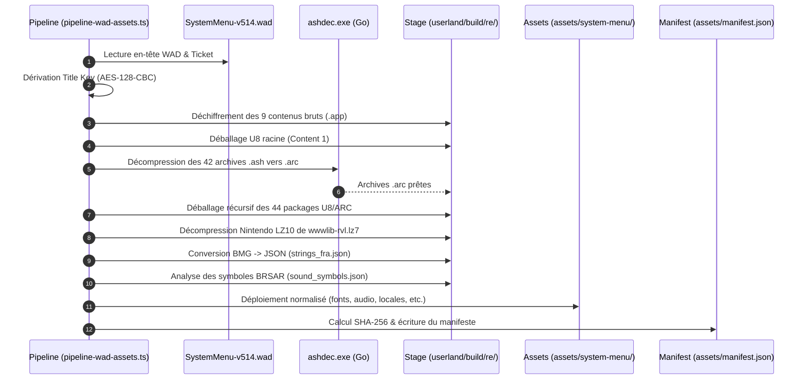

# Pipeline d'Extraction et Déploiement d'Assets Automatisée

Guide d'exécution et spécification technique de la pipeline automatisée, reproductible et idempotente de traitement des assets du **Menu Nintendo Wii**.

---

## 1. Vue d'Ensemble & Objectifs

La pipeline [`scripts/pipeline-wad-assets.ts`](file:///C:/src/wii/wii-os/scripts/pipeline-wad-assets.ts) prend en charge de façon totalement autonome le cycle de vie complet des données :
1. **Source** : `userland/data/wii/wads/System Software/SystemMenu-v514.wad`.
2. **Déchiffrement** : Validation des signatures TMD et dérivation de la clé de titre AES-128-CBC.
3. **Décompression** : Exécution du binaire natif Go `ashdec.exe` pour décompresser les 42 archives ASH0, et décompression LZ10 pour Opera.
4. **Extraction U8 / ARC** : Déballage récursif de toutes les archives de sous-systèmes.
5. **Consolidation** : Organisation normalisée dans `assets/system-menu/` (fonts, audio, locales, models, tokens, etc.).
6. **Génération du Manifeste** : Calcul des hachages SHA-256 et écriture de [`assets/manifest.json`](file:///C:/src/wii/wii-os/assets/manifest.json).

---

## 2. Commandes d'Exécution

### Via Bun (Recommandé)
```bash
bun run pipeline:assets
```

### Exécution Directe du Script TypeScript
```bash
bun scripts/pipeline-wad-assets.ts
```

### Reconstruction du Décompresseur ASH0 Natif (si nécessaire)
Le code source Go autonome se trouve dans [`scripts/ash0.go`](file:///C:/src/wii/wii-os/scripts/ash0.go) et peut être recompilé instantanément avec :
```bash
go build -o scripts/ashdec.exe scripts/ash0.go
```

---

## 3. Étapes Séquentielles du Traitement



---

## 4. Propriétés de la Pipeline

- **Idempotence** : Le script peut être relancé un nombre indéfini de fois sans altération des résultats, sans duplication et sans dérive d'état.
- **Vérification d'Intégrité Stricte** : Tout contenu ne correspondant pas aux signatures cryptographiques de Nintendo est immédiatement rejeté avant déballage.
- **Zéro Dépendance Externe Lourde** : La pipeline s'exécute nativement sous Bun v1.4+ avec un binaire Go léger pour ASH0, ne nécessitant ni Python, ni Java, ni installation complexe de machine virtuelle.
