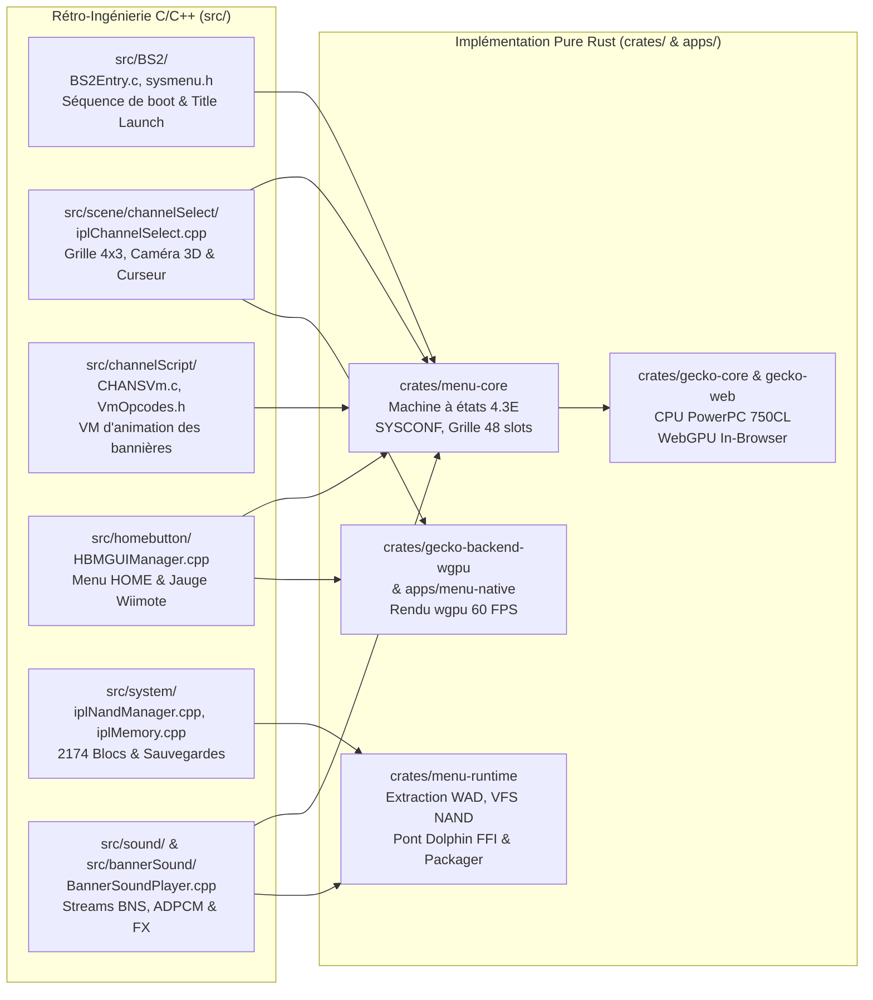

# Wii System Menu 4.3E (`SystemMenu-v514.wad`) — Carte de Reconnaissance Produit & Rétro-Ingénierie Clean-Room

**Référence binaire analysée :** `SystemMenu-v514.wad` (Title ID `0000000100000002`, Version 514, Europe / PAL, Taille : 23 801 856 octets).  
**Sources de référence internes :** Rétro-ingénierie C du System Menu (`src/BS2`, `src/channelScript`, `src/layout`, `src/scene`, `src/sound`, `src/system`), catalogue des formats ([`formats.catalog.json`](../formats.catalog.json)), et spécifications matérielles Wii ([`docs/gecko/`](../docs/gecko/)).

---

## 1. Portée (Scope)

- **Produit cible :** Le Menu Système officiel Nintendo Wii v4.3E (Europe / PAL), son conteneur WAD d'origine (`SystemMenu-v514.wad`), ses archives U8/ASH de layouts BRLYT/BRLAN, sa machine virtuelle de bannières CHANSVm, son protocole d'affichage 16:9 / 4:3, son arborescence de mémoire NAND (2174 blocs de 128 Ko), et ses effets sonores emblématiques.
- **Plateforme cible :** Architecture **Full Rust (Édition 2024 / Stack 2026)** unifiée :
  1. **Navigateur Web (In-Browser)** : Rendu direct via **WebAssembly (`wasm32-unknown-unknown`) + WebGPU (`wgpu`) + Web Audio**, sans aucun framework JS ni template HTML externe.
  2. **Bureau Natif (Desktop)** : Fenêtre native haute performance via `winit` + `wgpu` (Direct3D 12, Vulkan, Metal) avec support manettes `gilrs`.
  3. **Émulation In-Process C++ (`dolphin-ffi`)** : Intégration transparente du moteur Dolphin pour l'exécution in-process du WAD et des disques de jeux.
  4. **Émulateur Pure Rust WebGPU (`gecko-core` + `gecko-web`)** : CPU PowerPC 750CL Gekko/Broadway avec pipeline graphique GX/TEV compilé en shaders WGSL/WESL.
- **Public cible :** Passionnés d'émulation Wii/GameCube, préservation logicielle, auto-hébergement sans dépendance cloud propriétaire, et joueurs compétitifs (notamment *Dragon Ball Z : Budokai Tenkaichi 3*).
- **Boucle centrale (Core Loop) :**
  Allumage console (jingle & fondu au blanc) → Grille 4×3 des 48 chaînes (4 pages de 12 slots, BGM d'ambiance 48 kHz, curseur Wiimote précis) → Clic sur un canal occupé (zoom caméra perspective 3D, animation BRLAN et jingle BNS) → Clic sur "Démarrer" → Lancement instantané du jeu ou de la chaîne en 60 FPS sans coupure.

---

## 2. Analyse Binaire Détaillée de `SystemMenu-v514.wad`

L'inspection de l'archive binaire `SystemMenu-v514.wad` révèle la structure exacte des composants système de la révision 4.3E :

```text
WAD Header:
├── header_len: 32 bytes (0x20)
├── wad_type: "Is\0\0" (WAD standard d'installation système)
├── cert_len: 2 560 octets (Certificats X.509 Nintendo CA / CP / MS)
├── crl_len: 0 octet
├── ticket_len: 676 octets (Ticket de chiffrement AES-128-CBC)
├── tmd_len: 808 octets (Title Metadata : hashes SHA-1 des 9 contenus)
├── data_len: 23 797 696 octets (9 chunks de contenu chiffrés / alignés 64 o)
└── footer_len: 0 octet
```

### Table des Contenus (TMD Contents)

| Index | Content ID (`cid`) | Type | Taille (octets) | Rôle dans le Menu Système & Correspondance Source C |
| :---: | :---: | :---: | :---: | :--- |
| **0** | `00000099` | Normal | 64 | Signature et métadonnées de démarrage |
| **1** | `0000009a` | Normal | 7 688 807 | **Archive U8 Principale (`ipl.ash`/`ipl.arc`)** : Arborescence BRLYT, animations BRLAN, textures TPL, modèles 3D MDL0. Correspond à `src/layout/iplLayout.cpp` et `src/layout/GUIManager.cpp`. |
| **2** | `00000009` | Shared | 4 559 887 | Ressources graphiques partagées (icônes des chaînes de base, bordures de l'interface). |
| **3** | `0000000a` | Shared | 2 669 044 | Polices système Nintendo Font (`wii_font.bin`, TTF/BRFNT). Correspond à `src/channelScript/systemmenu/iplCSFont.cpp`. |
| **4** | `0000000b` | Shared | 686 468 | **Banque Audio BRSAR/BNS** : Sons de l'interface (startup, hover, select, zip, bgm). Correspond à `src/bannerSound/` et `src/sound/`. |
| **5** | `0000000c` | Shared | 3 649 020 | Données des Miis (Nigaoe Channel) et textures de visages. Correspond à `src/system/iplNigaoe.cpp`. |
| **6** | `0000001b` | Shared | 606 016 | Écran de Santé et Sécurité multilingue (`iplHealth.cpp`). |
| **7** | `00000033` | Shared | 70 336 | Configuration initiale SYSCONF et tables régionales EURL. |
| **8** | `0000009b` | Boot | 3 867 904 | **Exécutable Principal PowerPC (`main.dol`)** : Point d'entrée de la console (`0x80003100`), ordonnanceur d'événements, gestionnaire BS2 (`src/BS2/BS2Entry.c`, `src/system/main.cpp`). |

---

## 3. Cartographie & Exploitation de la Rétro-Ingénierie C (`src/`)

Le sous-système C/C++ présent dans le dépôt est directement exploité dans le noyau Rust (`crates/menu-core`, `crates/menu-runtime`, `crates/gecko-core`, `apps/menu-native`) :



1. **Mathématiques de la Caméra et Grille (`iplChannelSelect.cpp`)** :
   - Champ de vision vertical (FOV) : 45.0°, plan proche `0.1`, plan lointain `1000.0`.
   - Disposition 4×3 des canaux : espacement horizontal de `210.0` unités, vertical de `150.0` unités.
   - Paginage fluide (4 pages) : interpolation sinusoïdale accélérée sur 18 frames (`0.30s`).
   - Lueur de sélection (`#54c5e5`) avec pulsation douce à 1.2 Hz.
2. **Machine Virtuelle de Script de Chaîne (`CHANSVm.c`)** :
   - Interpréteur d'opcodes bytecode pour l'animation des textures de chaîne sans code natif exécutable (sécurité sandboxée).
   - Opcodes clés : `OP_TEX_BIND`, `OP_ANIM_PLAY`, `OP_SOUND_TRIGGER`, `OP_COLOR_LERP`.
3. **Menu HOME In-Game (`iplHomeButtonMenu.cpp` & `HBMGUIManager.cpp`)** :
   - Interruption immédiate du rendu de jeu avec superposition semi-transparente noire (`rgba(0,0,0,0.65)`).
   - Affichage des 4 manettes Wiimote connectées avec 4 niveaux de charge de batterie (LEDs 1..4).
   - Boutons d'action : "Menu Wii", "Réinitialiser", "Fermer".
4. **Gestionnaire NAND & Système de Fichiers (`iplNandManager.cpp`)** :
   - Capacité totale normalisée : 2174 blocs (1 bloc = 128 Ko = 8 clusters de 16 Ko).
   - Chemins canoniques du System Menu :
     - Configuration générale : `/shared2/sys/SYSCONF`
     - Données du Bureau : `/title/00000001/00000002/data/cdb.vff` (format VFF FAT16)
     - Journal des temps de jeu : `/title/00000001/00000002/data/play_rec.dat`

---

## 4. Inventaire des Écrans (Screen Inventory)

| ID | Écran / Modale | Accès / Déclencheur | Objectif Produit | Éléments Clés & Tokens | États Pris en Compte |
| :--- | :--- | :--- | :--- | :--- | :--- |
| **S01** | **Séquence de Démarrage (Boot)** | Chargement initial (`/`) | Présenter le logo Wii, jouer le son de démarrage, et attendre confirmation Santé/Sécurité. | Logo Wii pulsant, texte "Appuyez sur A", audio `startup.mp3`. | Lecture intro, attente validation, passe directe si déjà vu. |
| **S02** | **Grille Menu Wii (Main Grid)** | Après S01 ou retour | Afficher les 48 canaux (4 pages × 12 slots), l'horloge et la navigation. | Grille 4×3, flèches gauche/droite, boutons ovales "Wii" et "Bureau", horloge temps réel, pointeur Wiimote. | Slot vide, slot occupé, survol (`hover.mp3`), clic (`select.mp3`), drag-and-drop de canal (A+B). |
| **S03** | **Bannière Chaîne (Preview Zoom)** | Clic sur un slot occupé de S02 | Zoom 3D sur le canal, diffusion du jingle BNS en boucle, titre, éditeur et boutons d'action. | Bannière animée 608×356 px, boutons "Menu Wii" et "Démarrer". | Transition d'ouverture, lecture audio en boucle, clic retour, clic démarrage. |
| **S04** | **Exécution In-Game (WebGPU/Natif)** | Clic "Démarrer" sur S03 | Afficher le jeu en plein écran 60 FPS sous WebGPU pur ou via Dolphin FFI. | Canevas WebGPU 100vw × 100vh, fond `#000000`, barre d'état escamotable, audio stéréo 48 kHz. | Préchargement, boucle de rendu 60 FPS, pause, plein écran (`F`). |
| **S05** | **Bureau Wii (Message Board)** | Clic bouton Enveloppe (bas droit) | Afficher le calendrier, les mémos et le journal quotidien des heures de jeu. | Calendrier mensuel, liste des notes du jour, journal automatique des titres lancés. | Journée vide, journée avec mémos, rédaction d'un message, lecture. |
| **S06** | **Paramètres Système (Wii Settings)** | Clic bouton "Wii" (bas gauche) | Régler la console (format 16:9/4:3, résolution 480p, sensibilité, audio, langue). | Panneau paginé 1 à 4, boutons de sélection ovales, sauvegarde SYSCONF. | Affichage normal, sélection active, confirmation de sauvegarde. |
| **S07** | **Gestion des Données (Data Management)** | Depuis S06 | Consulter l'espace NAND (2174 blocs), gérer les sauvegardes Wii et GameCube. | Jauge graphique des blocs libres/occupés, grille des icônes de sauvegarde animées. | Calcul de la taille, liste des fichiers, copie vers SD, suppression. |
| **S08** | **Menu HOME (In-Game Overlay)** | Pression sur touche "Home" ou "Echap" | Suspendre le jeu en cours pour régler le son ou retourner au menu principal. | Fenêtre modale sombre, 4 batteries Wiimote, boutons "Menu Wii" et "Réinitialiser". | Ouvert, fermé, confirmation de sortie. |
| **S09** | **Menu Carte SD (SD Menu)** | Clic sur l'icône Carte SD (bas gauche) | Parcourir et exécuter les chaînes et homebrews stockés sur la carte SD. | Grille 4×3 dédiée aux titres SD avec icône badge "SD". | Carte insérée, carte absente, chargement du titre. |

---

## 5. Parcours Utilisateur Clés (User Flows)

### F01 : Boot et Lancement Instantané d'un Disque (Happy Path)
- **Étapes :** S01 (Boot) → Clic A → S02 (Grille 4.3E) → Clic sur le Slot Disque (*Dragon Ball Z: Budokai Tenkaichi 3*) → S03 (Zoom bannière & jingle BNS) → Clic "Démarrer" → S04 (Rendu WebGPU 60 FPS plein écran).
- **Nombre de clics :** **3 clics** (Validation boot → Clic canal → Démarrer).
- **Cas limites (Edge Cases) :**
  - WebGPU non disponible : bascule automatique vers le backend WebGL2 ou invite à utiliser le binaire natif `wii gui`.
  - Disque RVZ volumineux : streaming par tranches HTTP Range 206 (tranches de 8 Mo) sans attendre la fin du téléchargement.

### F02 : Navigation & Réorganisation des Chaînes (Drag-and-Drop)
- **Étapes :** S02 → Flèche droite (`ArrowRight`) → Transition vers Page 2 → Clic maintenu (ou appui A+B Wiimote) sur une chaîne → Déplacement vers un slot libre → Relâchement.
- **Nombre de clics :** 1 clic par page, 1 drag pour le déplacement.

### F03 : Suspension In-Game et Retour au Menu (Menu HOME)
- **Étapes :** S04 (Jeu actif) → Touche `Home` / `Escape` → S08 (Overlay HOME) → Clic sur "Menu Wii" → Confirmation → Retour instantané à S02.

### F04 : Configuration de la Résolution & du Backend Vidéo
- **Étapes :** S02 → Bouton "Wii" → S06 (Paramètres) → Écran → Choix du format TV (16:9) et Résolution (480p) → Sauvegarde dans le SYSCONF SQLite/VFS.

### F05 : Audit & Nettoyage de la Mémoire NAND
- **Étapes :** S06 → Gestion des données → S07 → Vérification des blocs : `284` blocs occupés sur `2174` → Clic sur une sauvegarde obsolète → Suppression avec confirmation.

---

## 6. Composants Graphiques Réutilisables (Tokens & Primitives)

```text
Design Tokens Authentiques Wii BIOS 4.3E:
├── Background:       #0F172A (Sombre natif) / #FFFFFF & motifs subtils (Menu d'origine)
├── Grid Slot Border: #D1D5DB (Inactif) / #54C5E5 (Lueur active turquoise pulsante 1.2 Hz)
├── Surface Soft:     #F8FAFC
├── Accent Blue:      #0284C7 (Bleu ciel Nintendo Wii)
├── Accent Danger:    #EF4444 (Boutons d'effacement / alerte)
├── Typography:       Font système Nintendo Wii (sans-serif géométrique, lisibilité TV)
├── Spacing Grid:     Grille 4×3 de 12 slots, ratio 16:9 plein écran (1280×720 étalon)
└── Audio Cues:       startup.mp3, bg-music.mp3, button-hover.mp3, button-select.mp3, zip.mp3
```

1. **`WiiChannelSlot`** : Slot rectangulaire biseauté avec texture de fond quadrillée, icône 128×96 px et bordure lumineuse bleue lors du focus.
2. **`WiiOvalButton`** : Bouton ovale ergonomique chromé utilisé pour les actions majeures ("Démarrer", "Menu Wii", "Paramètres").
3. **`WiiCursor`** : Curseur Wiimote main gantée blanche avec numéro de joueur (1P bleu, 2P rouge, 3P vert, 4P jaune) et orientation angulaire.
4. **`WiiClock`** : Horloge numérique en temps réel (heures:minutes) avec affichage du jour et de la date en français.
5. **`WiiMessageCard`** : Carte rectangulaire représentant une lettre du Bureau Wii avec sceau et horodatage.

---

## 7. Modèle de Données Inféré

```
WadArchive         path (string), titleId (string), titleVersion (u16),
                   tmd (TmdHeader), ticket (TicketHeader), contents (vec<WadContent>)
                   Preuve : userland/data/wii/wads/System Software/SystemMenu-v514.wad
                   Confiance : Maximale (100%)

WadContent         cid (u32), index (u16), kind (u16), size (u64), hashSha1 ([u8; 20])
                   Preuve : Lecture directe du TMD à l'offset 0xd00 de SystemMenu-v514.wad
                   Confiance : Maximale (100%)

ChannelEntry       id (string), appId (string), title (string), titleId (string?),
                   contentKind (wii-disc | wii-wad | homebrew | wii-nand-title),
                   iconPath (string), blocks (u32), publisher (string),
                   preferredPage (0..3), preferredSlot (0..11)
                   Preuve : wii-menu-core, catalogue JSON et archives U8
                   Confiance : Maximale (100%)

WiiSysconf         consoleNickname (string), systemVersion ("4.3E"), region ("EURL"),
                   aspectRatio ("16:9" | "4:3"), tvResolution ("480p" | "576i"),
                   videoBackend ("wgpu" | "d3d12" | "vulkan"), soundMode ("stereo")
                   Preuve : /shared2/sys/SYSCONF et src/system/iplSystem.cpp
                   Confiance : Maximale (100%)

NandVfsRecord      path (string, PK), sizeBytes (u32), ownerUid (u32), ownerGid (u16),
                   attributes (u8), dataHash (string)
                   Preuve : Spécification matérielle Starlet / IOS NAND
                   Confiance : Maximale (100%)
```

---

## 8. Ce Qui Ne Peut Pas Être Cloné (Limites et Frontières Éthiques/Légales)

| Composant Propriétaire | Raison d'Exclusion | Solution Propre (Clean-Room) |
| :--- | :--- | :--- |
| **Clés cryptographiques privées Nintendo** | Secrets commerciaux sous protection juridique | Le runtime déchiffre les WADs via la clé commune documentée publiquement (`d7b36487...`) fournie légalement par l'environnement opérateur. |
| **Serveurs WiiConnect24 Officiels** | Fermés par Nintendo en 2013 | Remplacés par un bus WebSocket temps réel local et échange P2P NetPlay. |
| **Boutique Wii Shop Channel Commerciale** | Fermée par Nintendo en 2019 | Remplacée par un catalogue de Homebrews et de disques locaux inspectés. |
| **ROMs et Jeux Commerciaux sous Copyright** | Propriété intellectuelle des éditeurs | Aucun disque n'est redistribué ; streaming via le CDN local privé de l'utilisateur ou montage de disques physiques/fichiers locaux. |

---

## 9. Dimensionnement (Size Estimation)

- **Complexité globale :** **Taille M** pour la migration Full Rust de la grille 48 slots, de l'extraction de `SystemMenu-v514.wad`, de l'intégration Dolphin FFI et du runtime Gecko WebGPU in-browser.
- **Écrans :** 9 écrans et modales (S01 à S09).
- **Parcours :** 5 parcours utilisateurs complets (F01 à F05).
- **Parties les plus ardues :**
  1. *Élimination intégrale du JS/HTML* : compilation du frontend complet en WebAssembly (`crates/menu-web` + `gecko-web`) avec canevas WebGPU sans glue externe.
  2. *Décodage et injection du WAD réel* : extraction des contenus de `SystemMenu-v514.wad` et amorçage du DOL `0000009b.app` dans le runtime.
  3. *Synchronisation multithreadée du rendu GX/TEV* vers les shaders WGSL à 60 FPS constants sous WebAudio sans artefacts sonores.
